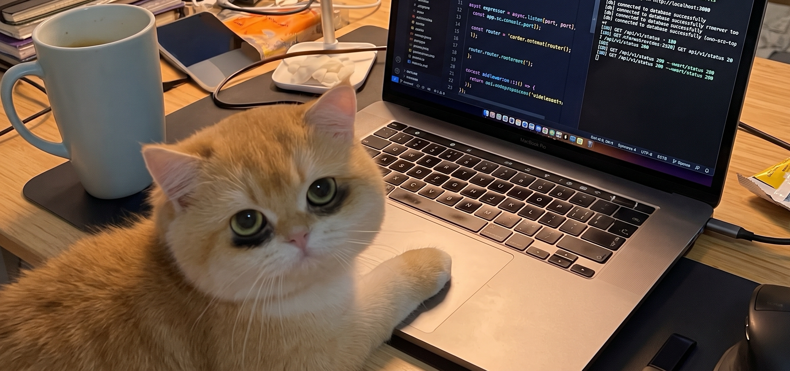
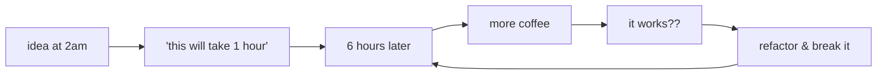

<p align="center">
  <h1 align="center">sup, I'm Ryan 👋</h1>
  <p align="center"><i>building stuff on the internet, fueled by coffee and questionable sleep schedules</i></p>
</p>

<p align="center">
  
  <br />
  <i>live footage of me shipping to prod on a Monday ☕</i>
</p>

---

### 😮‍💨 current status

```txt
$ whoami
> ryan — builds stuff, breaks stuff, fixes stuff, repeats

$ facecam
> tired-cat.jpeg (yes, that is literally me)

$ sleep-schedule
> 404 not found
```

one paw on the trackpad, giant mug of coffee on the left, eyebags bigger than my backlog. we vibe.

### 🧠 what i do

i spend most of my time building SaaS products, backend systems, and random side projects that start as *"wait, this should only take an hour"* and somehow turn into a whole weekend.

- contributing to open source, shipping products, and chasing 2am ideas that got way out of hand
- mostly living in **TypeScript, React, Node, Python, and Go**
- staring at the terminal until the bug confesses out of guilt
- 80% caffeine, 20% *"let me just fix this one tiny thing before bed"*

### 📊 my dev lifecycle



okay github eats mermaid charts sometimes, so here's the real version:

> 2am idea → *"easy 1hr build"* → sun comes up → eyebags get darker → coffee #3 → it works → ship it 🚀

<!-- DAILY_ASSET:START -->
<p align="center">
  
</p>
<!-- DAILY_ASSET:END -->

### 🐾 meet the team

| who | role | current status |
|------|------|--------------|
| **me** *(the orange one)* | lead dev, QA, & victim | running on 3 hours of sleep and pure stubbornness |
| **the blue mug** | project manager | carrying the entire operation on its back |
| **the eyebags** | senior architect | earned from debugging in the dark |
| **`localhost:3000`** | the opp | connected to the db 4 times in a row just to be sure |

> *"i'll fix my sleep schedule right after this next deploy."* — me, lying to myself every week

### ⚡ fun facts

- [ ] my code has fewer red flags than my sleep schedule
- [ ] my toxic trait is thinking *"how hard could it be to build that from scratch?"*
- [ ] `git commit -m "fix"` is my love language
- [ ] 90% of my architecture decisions are made at 3am with one paw on the trackpad

### 📫 find me

- github — you're already here
- got a cool idea? hit my email or socials *(right up there below my profile pic)* — i'm probably still awake anyway

---

<p align="center">
  <b>thanks for stopping by — go drink some water and get some sleep</b><br/>
  <i>zero hours of sleep were respected in the making of this profile</i> 🐈
</p>
