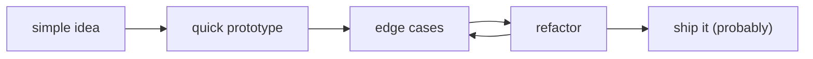

<!--
  THE CURIOUS HUMAN
  an independent corner of the internet.

  maintained by ryan akmal
  and an increasingly questionable engineering department.
-->

  AN INDEPENDENT CORNER OF THE INTERNET &nbsp; / &nbsp; RYANAKML

 

# hey, i'm ryan

**i build software, explore rabbit holes, and occasionally make simple things unnecessarily complicated.**

somewhere between engineering things that work and making things that are fun to look at.

developer by practice &nbsp;·&nbsp; curious human by default &nbsp;·&nbsp; professional overthinker by accident

 

<!-- HEADER_ASSET:START -->

  
   
  <i>fig. 01 — meet today's engineer. qualifications remain undisclosed.</i>

<!-- HEADER_ASSET:END -->

 

---

001 / THE HUMAN

## a little about me.

i like understanding how things work.

sometimes that means building a product. sometimes it means taking an AI model apart to understand what's happening underneath. and sometimes it means spending an unreasonable amount of time automating something that absolutely did not need automation.

i'm interested in the space between **software engineering, intelligent systems, and creative problem-solving.**

i like the complicated parts — architecture, edge cases, reliability, and the tiny details that make software feel thoughtfully built.

but i also think the internet could use a little more personality.

 

### where my time goes

*i like building both sides of the loading spinner.*

<table width="100%">
  <tr>
    <td width="50%" valign="top">
      ON SCREEN / 01
        
      <strong>the part you click.</strong>
        
      interfaces, interactions, and the little details that make software feel right.
    </td>
    <td width="50%" valign="top">
      BEHIND THE SCENES / 02
        
      <strong>the part keeping it alive.</strong>
        
      APIs, background jobs, queues, and the things nobody notices until they stop working.
    </td>
  </tr>
</table>

good software should work. great software should feel like someone cared.

 

---

002 / SELECTED WORK

<h2>
  <del>things i made</del> 
  things i build instead of going outside.
</h2>

a few projects, experiments, and ideas that escaped the notes app.

 

### 01 / [wabrix ↗](https://github.com/Ryanakml/wabrix)

**sometimes the best bot feature is knowing when to stop talking.**

a WhatsApp-first AI communication platform combining knowledge-grounded responses with a real-time operator inbox.

exploring how automation and human handoff can work together without turning customer support into a conversation with a wall.

<code>typescript</code> &nbsp; <code>next.js</code> &nbsp; <code>convex</code> &nbsp; <code>cloudflare workers</code>

 

### 02 / [deadbolt ↗](https://github.com/Ryanakml/Deadbolt)

**because `retry()` isn't a recovery strategy.**

an early-stage durable workflow system exploring what happens when background jobs fail, workers disappear, or execution needs to resume without starting everything over.

currently focused on architecture, recovery semantics, and execution foundations.

<code>go</code> &nbsp; <code>typescript</code> &nbsp; <code>distributed systems</code>

 

### 03 / [flowdesk ↗](https://github.com/Ryanakml/FlowDesk)

**turns out "just send a message" needs a whole architecture.**

building the execution foundation for a WhatsApp automation platform, with background workers, queues, scheduling, and observability.

still early. currently more infrastructure than finished product — which is kind of the interesting part.

<code>typescript</code> &nbsp; <code>workers</code> &nbsp; <code>queues</code> &nbsp; <code>observability</code>

 

### 04 / [nylo.me ↗](https://github.com/Ryanakml/nylo.me)

**a portfolio that got a little carried away.**

my other corner of the internet.

an interactive portfolio exploring motion, creative interfaces, and what happens when a developer discovers one too many animation libraries.

<code>react</code> &nbsp; <code>motion</code> &nbsp; <code>three.js</code>

 

AND OCCASIONALLY, OTHER PEOPLE'S CODEBASES.

sometimes i wander into open source too.

[see my merged contributions ↗](https://github.com/search?q=author%3ARyanakml+is%3Apr+is%3Amerged+-user%3ARyanakml&type=pullrequests)

 

---

003 / RABBIT HOLES

<h2>
  some people collect stamps. 
  i collect unfinished questions.
</h2>

i have a habit of wanting to understand what's happening under the hood.

especially when the explanation starts with *"it's complicated."*

| rabbit hole | the interesting part |
| :--- | :--- |
| **machine learning** | the math behind the predictions |
| **neural networks** | building the pieces instead of treating them as magic |
| **language models** | attention, transformers, and how machines represent language |
| **computer vision** | making sense of pixels |
| **distributed systems** | making unreliable things behave reliably |

some experiments become useful projects.

others become very long README files.

somewhere down the rabbit hole ↗

 

a few things i've explored:

- [LLaMA from scratch](https://github.com/Ryanakml/LLaMA-From-Scratch) — understanding language models from the inside.
- [DIY neural network](https://github.com/Ryanakml/DIY-Neural-Network-from-Scratch) — because using a library felt suspiciously convenient.
- [attention in 3D](https://github.com/Ryanakml/Attention-Process-in-3D) — exploring an abstract idea through a visual one.
- [reinforcement learning](https://github.com/Ryanakml/Reinforcement-Learning-Concept-and-Implementation) — learning through rewards, mistakes, and more mistakes.

[the rest of the archive ↗](https://github.com/Ryanakml?tab=repositories)

 

---

004 / THE TOOLBOX

## tools of the trade.

a few things that tend to show up in my editor.

| | |
| :--- | :--- |
| **languages** | TypeScript · Python · Go |
| **interfaces** | React · Next.js |
| **backend** | Node.js · APIs · background workers |
| **systems** | databases · queues · workflow orchestration |
| **intelligence** | machine learning · LLMs · AI applications |
| **essentials** | Git · Docker · debugging things i broke myself |

tools change. curiosity is harder to uninstall.

 

---

005 / THE PROCESS

## how it usually goes.

the part they don't show in the demo:

> the first version works. then someone clicks a button i forgot existed.

 

---

006 / THE ENGINEERING DEPARTMENT

<h2>
  highly qualified. 
  <del>probably.</del>
</h2>

the engineering department consists of one developer, an unreasonable number of browser tabs, and a rotating cast of exhausted animals.

yes, the animal at the top changes automatically.

no, this was not a business requirement.

meet the rest of the team ↗

 

| employee | position | current status |
| :--- | :--- | :--- |
| **me** | lead dev, QA & victim | reviewing my own code like someone else wrote it |
| **the blue mug** | project manager | carrying the entire operation |
| **the logs** | witness | saw everything. refuses to elaborate |
| **localhost:3000** | the opp | works on my machine |

 

<!-- DAILY_ASSET:START -->

  

<!-- DAILY_ASSET:END -->

 

the department is currently accepting coffee.

 

---

007 / KNOWN ISSUES

## known issues (won't fix)

- [ ] i trust tests. i still refresh the page one more time.
- [ ] my toxic trait is thinking *"how hard could it be to build that from scratch?"*
- [ ] `git commit -m "fix"` is my love language.
- [ ] naming things has taken longer than implementing them.

one last thing ↗

 

`git blame` says it was me.

i'd like a second opinion.

 

---

008 / ELSEWHERE

## the internet is a small place.

got a weird idea, an interesting bug, or something you're building?

i'm always up for a good conversation.

**[nylo.me ↗](https://nylo.me)** — my other portfolio. apparently one wasn't enough.

email and socials are up there, below the profile picture. very professional placement, i know.

 
 

---

 

  YOU'VE REACHED THE END OF THIS CORNER OF THE INTERNET.

<h2 align="center">anyway, back to the editor.</h2>

  <i>thanks for stopping by. the engineering department says hi.</i>

 

  RYAN AKMAL &nbsp; / &nbsp; END OF DOCUMENT

