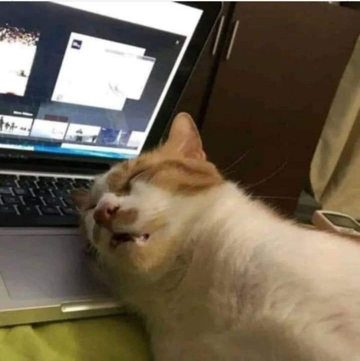
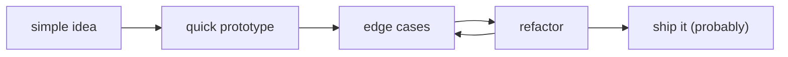

<p align="center">
  <h1 align="center">sup, I'm Ryan 👋</h1>
  <p align="center"><i>building software, collecting edge cases, and occasionally making simple things complicated.</i></p>
</p>

<!-- HEADER_ASSET:START -->
<p align="center">
  
  <br />
  <sub><i>live footage of me shipping to prod on a Monday ☕</i></sub>
</p>
<!-- HEADER_ASSET:END -->

---

### 😮‍💨 current status

```txt
$ whoami
> ryan — builds stuff, breaks stuff, fixes stuff, repeats

$ facecam
> tired-cat.jpeg (yes, that is literally me)

$ sleep-schedule
> 404 not found
```

### 🧠 what i do

i spend most of my time building SaaS products, backend systems, and random side projects that start as *"wait, this should only take an hour"* and somehow turn into a whole weekend.

- building the UI people click and the background jobs nobody notices
- mostly living in **TypeScript, React, Node, Python, and Go**
- staring at the terminal until the bug confesses out of guilt
- discovering that *"works on my machine"* is a surprisingly specific achievement

<h3><sub><del>things i made</del></sub><br />things i build instead of going outside</h3>

some side quests got a little out of hand:

- **[deadbolt](https://github.com/Ryanakml/Deadbolt)** — designing durable workflows and worker recovery. still early; turns out `retry()` isn't a recovery strategy.
- **[flowdesk](https://github.com/Ryanakml/FlowDesk)** — laying the foundations for WhatsApp automation: workers, queues, observability. apparently "just send a message" needs a whole architecture.
- **[wabrix](https://github.com/Ryanakml/wabrix)** — an AI-assisted WhatsApp inbox with grounded replies and human handoff. sometimes the best bot feature is knowing when to stop talking.
- **[nylo.me](https://github.com/Ryanakml/nylo.me)** — my corner of the internet. gave a portfolio more motion than saying "hi" probably required.

sometimes i wander into other people's codebases too — [merged PRs](https://github.com/search?q=author%3ARyanakml+is%3Apr+is%3Amerged+-user%3ARyanakml&type=pullrequests).

### 📊 my dev lifecycle



the part they don't show in the demo:

> the first version works. then someone clicks a button i forgot existed.

### 🐾 meet the team

<table align="center" width="100%">
  <thead>
    <tr>
      <th width="280" align="center">who</th>
      <th width="260" align="center">role</th>
      <th width="460" align="center">current status</th>
    </tr>
  </thead>
  <tbody>
    <tr>
      <td align="center"><b>me</b> <i>(the orange one)</i></td>
      <td align="center">lead dev, QA, &amp; victim</td>
      <td align="center">reviewing my own code like someone else wrote it</td>
    </tr>
    <tr>
      <td align="center"><b>the blue mug</b></td>
      <td align="center">project manager</td>
      <td align="center">carrying the entire operation on its back</td>
    </tr>
    <tr>
      <td align="center"><b>the logs</b></td>
      <td align="center">witness</td>
      <td align="center">saw everything. refuses to elaborate.</td>
    </tr>
    <tr>
      <td align="center"><code>localhost:3000</code></td>
      <td align="center">the opp</td>
      <td align="center">connected to the db 4 times in a row just to be sure</td>
    </tr>
  </tbody>
</table>


<br />

---

<!-- DAILY_ASSET:START -->
<p align="center">
  
</p>
<!-- DAILY_ASSET:END -->

<p align="center">
  <i>"we should probably document this."</i> — things said after the third incident
</p>


---


### ⚡ fun facts

- [ ] i trust tests. i still refresh the page one more time
- [ ] my toxic trait is thinking *"how hard could it be to build that from scratch?"*
- [ ] `git commit -m "fix"` is my love language
- [ ] naming things has taken longer than implementing them

### 📫 find me

- github — you're already here
- got a weird idea or an interesting bug? email and socials are up there *(below the profile pic)*

---

<p align="center">
  <b>anyway, back to the editor.</b><br />
  <sub><i>thanks for stopping by 🐈</i></sub>
</p>
